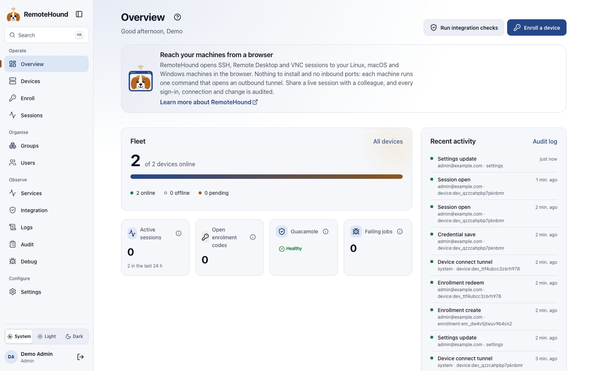
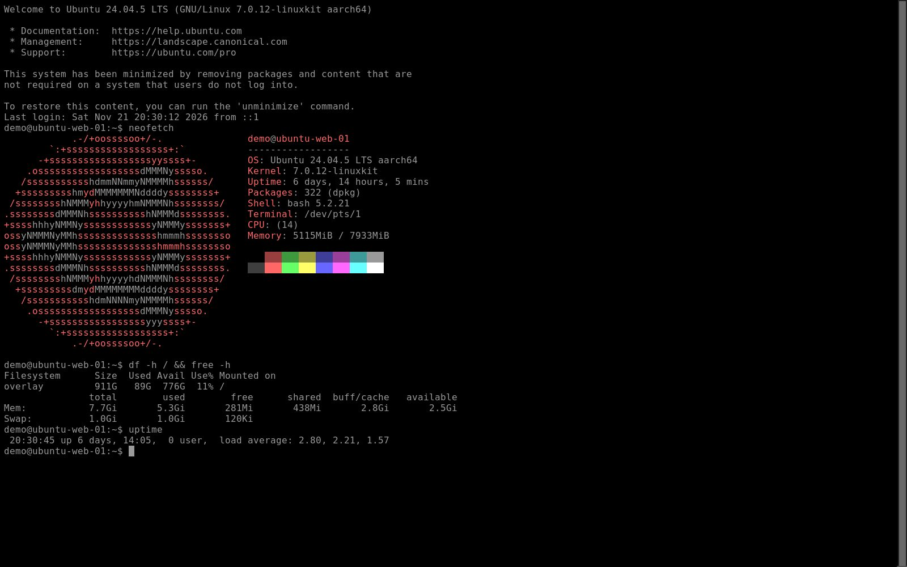
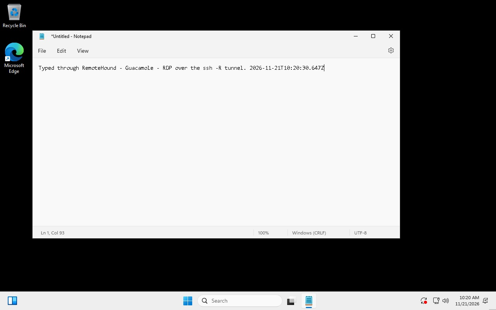
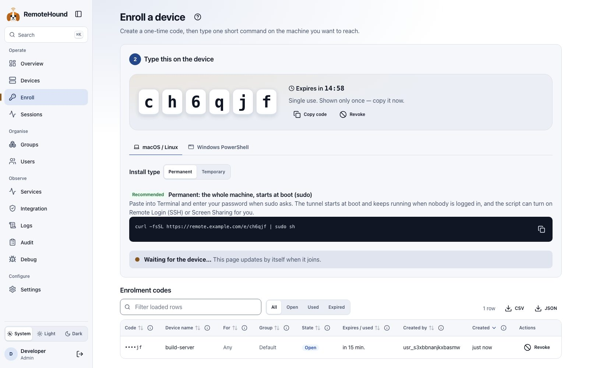
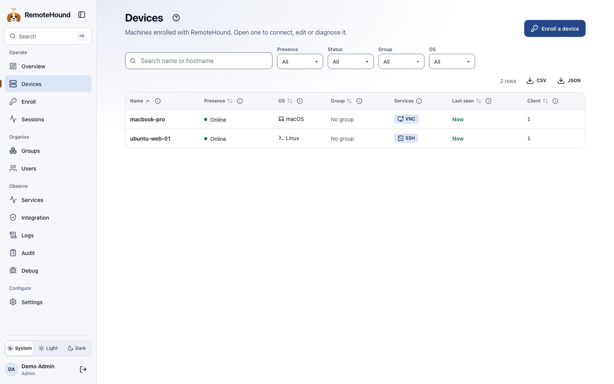
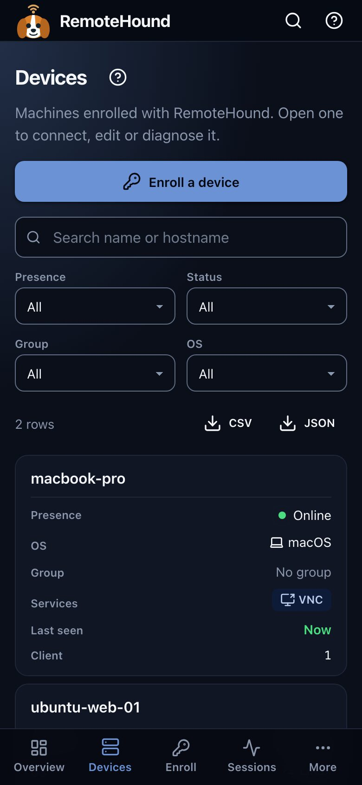
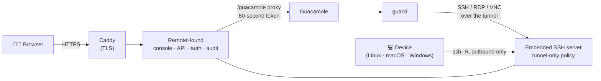

<div align="center">

<picture>
  <source media="(prefers-color-scheme: dark)" srcset="docs/img/logo-dark.svg">
  <source media="(prefers-color-scheme: light)" srcset="docs/img/logo-light.svg">
  
</picture>

### Reach your Linux, macOS and Windows machines from any browser.
**No client to install. No inbound ports. No one at the other end clicking "Allow".**

[](https://github.com/jchirayath/remotehound/actions/workflows/ci.yml)
[](https://github.com/jchirayath/remotehound/releases)
[](go.mod)
[](LICENSE)
[](https://securityscorecards.dev/viewer/?uri=github.com/jchirayath/remotehound)

[**Quick start**](#-quick-start) · [How it works](#-how-it-works) · [Screenshots](#-screenshots) · [Security](#-security-model) · [Docs](#-documentation) · [Contributing](#-contributing)

<br>



</div>

<br>

## One command on the machine. Every session from the browser.

Someone at the remote machine types one line:

```bash
# macOS / Linux
curl -fsSL https://rh.example.com/e/k7q2mx | sudo sh

# Windows (PowerShell as Administrator)
irm https://rh.example.com/e/k7q2mx | iex
```

From then on you open **SSH, Remote Desktop or VNC** sessions to that machine from any browser — your
phone included. Nothing is installed: the command uses the `ssh`, `curl`/`irm` and remote-desktop servers
the OS already ships, writes a key and a service entry, and keeps an outbound tunnel up.

> [!TIP]
> No admin rights on the machine? Pick **Temporary** on the Enroll screen: it runs as one user, needs no
> `sudo`, and you can **Make it permanent** later.

## ✨ Features

<table>
<tr>
<td width="33%" valign="top">

### 🔌 Zero-install enrolment
A one-time, 15-minute, single-use code and one typed command. The key is generated **on the device**;
a tiny watchdog keeps the tunnel up under systemd, launchd or Task Scheduler.

</td>
<td width="33%" valign="top">

### 🌐 Through any NAT
Devices dial **out** over plain `ssh -R` to RemoteHound's embedded SSH server. No port forwarding, no VPN,
no relay service — if the machine can reach your server on one TCP port, it works.

</td>
<td width="33%" valign="top">

### 🖥️ Full desktops in a tab
Sessions render in [Apache Guacamole](https://guacamole.apache.org/): SSH terminals, Windows RDP and
macOS Screen Sharing, from desktop or mobile browsers.

</td>
</tr>
<tr>
<td valign="top">

### 👥 Built for teams
Each operator saves their own device logins and gets their own OS session. Invite a colleague to
**view** or **control** a live session for a set time. Groups scope who sees what.

</td>
<td valign="top">

### 🔐 Sign in your way
Microsoft Entra ID, Google, Apple, Facebook, GitHub or any OIDC provider — mix and match — or put it
behind your own authenticating proxy. Roles: admin, operator, viewer.

</td>
<td valign="top">

### 📜 Every action on the record
Hash-chained audit log, structured redacted logs with live tail, Prometheus metrics, health and
integration checks, and self-healing jobs on both server and devices.

</td>
</tr>
</table>

## 📸 Screenshots

<table>
<tr>
<td width="50%"><br><sub><b>Linux over SSH</b> — an Ubuntu 24.04 server enrolled with the one-liner.</sub></td>
<td width="50%"><br><sub><b>Windows over RDP</b> — a full Windows 11 desktop, typed into through the tunnel.</sub></td>
</tr>
<tr>
<td><br><sub><b>Enroll</b> — a one-time code, Permanent or Temporary install, and the page updates when the device joins.</sub></td>
<td><br><sub><b>Devices</b> — presence, OS, available services and health at a glance.</sub></td>
</tr>
</table>

<p align="center">
  <br>
  <sub><b>Mobile-first, light and dark.</b> The whole console works from a phone.</sub>
</p>

## 🧭 How it works



1. An operator creates a one-time code (**Enroll**). It is shown once, lives 15 minutes, and is single use.
2. The person runs the command. The script generates a key **on the device**, registers it, turns on the
   built-in services it can (with admin rights), and installs a watchdog.
3. The device keeps an `ssh -R` tunnel to RemoteHound's embedded SSH server — which allows **only** the
   device's declared forwards. No shell, no local forwards.
4. **Connect** mints a 60-second, single-connection Guacamole token (guacamole-auth-json). Guacamole has no
   users or database of its own; RemoteHound is the only authority.
5. Sessions are private to their owner, who can invite others to view or control. Admins see every session
   and can end any of them, but cannot join one without an invitation.

Deep dive: [docs/ARCHITECTURE.md](docs/ARCHITECTURE.md) · API: [api/openapi.yaml](api/openapi.yaml) ·
device protocol: [docs/specs/CLIENT_PROTOCOL.md](docs/specs/CLIENT_PROTOCOL.md)

### Why not just…

| | **RemoteHound** | Guacamole on its own | Agent-based remote-support tools |
|---|:---:|:---:|:---:|
| Reaches machines behind NAT without port forwarding | ✅ | ❌ needs a route to each host | ✅ |
| Nothing to install or update on the device | ✅ | ✅ | ❌ full agent |
| Unattended access (no one clicks "Allow") | ✅ | ✅ | varies |
| One-line enrolment, device inventory, health | ✅ | ❌ | ✅ |
| Full desktop in any browser, phone included | ✅ | ✅ | varies |
| Self-hosted, open source, one Go binary + compose bundle | ✅ | ✅ | varies |

RemoteHound was built for reaching **your own** machines — a VM that's only on when needed, a server, a
laptop left at home — where an attended-support tool's "the person at the other end approves" model gets
in the way. Consent is given once, by whoever runs the command; after that every connection is audited.

## 🚀 Quick start

**You need:** a Docker host with a DNS name, ports 80/443 for the console, and TCP 2222 reachable by
your devices.

```bash
git clone https://github.com/jchirayath/remotehound && cd remotehound/deploy
cp .env.example .env && chmod 600 .env
docker run --rm ghcr.io/jchirayath/remotehound gen-secret >> .env
$EDITOR .env          # set RH_DOMAIN, RH_PUBLIC_URL, sign-in provider(s), bootstrap admin
docker compose up -d
```

Open `https://<your domain>`, sign in as the bootstrap admin, check **Integration** is all green, then
**Enroll** your first machine. The full guide — sign-in providers, backups, upgrades, rotating
secrets — is in [docs/RUNBOOK.md](docs/RUNBOOK.md); every setting is in [docs/CONFIG.md](docs/CONFIG.md).

<details>
<summary><b>Verify the image before you run it</b></summary>

Release images are built by GitHub Actions with an SBOM and a signed build-provenance attestation:

```bash
gh attestation verify oci://ghcr.io/jchirayath/remotehound:<version> --repo jchirayath/remotehound
```
</details>

<details>
<summary><b>Run from source for development</b></summary>

Go 1.26 is the only toolchain — the web UI has no build step and no npm dependencies.

```bash
RH_ENV=development RH_AUTH_MODE=dev RH_HTTP_ADDR=127.0.0.1:8080 RH_PUBLIC_URL=http://127.0.0.1:8080 \
RH_DATA_DIR=./.data RH_TUNNEL_BIND=127.0.0.1 go run ./cmd/remotehound
```

`RH_AUTH_MODE=dev` signs everyone in as a developer — keep it on loopback.
</details>

## 🛡️ Security model

RemoteHound hands out access to other people's computers, so the design starts from what a stolen piece
can do:

- **A device key** can only hold open the forwards that device declared. No shell, no exec, no local
  forwards — the whole policy lives in one file, [`internal/tunnel/server.go`](internal/tunnel/server.go),
  with a denied-path test for every refusal.
- **A Guacamole token** lives 60 seconds and opens one connection. Guacamole itself has no users and no database.
- **An operator** sees only their groups' devices (other groups' resources are a 404, not a 403), and
  saved device logins are sealed per user.
- **Everything** that changes state is written once to a hash-chained audit log; logs are redacted at
  the single logging module.
- **Supply chain:** one external Go module (`golang.org/x/crypto`), distroless non-root image pinned
  by digest, CI actions pinned to commit SHAs, whole-history secret scanning, `govulncheck` and Trivy on
  every push.

Threats and mitigations: [docs/THREAT_MODEL.md](docs/THREAT_MODEL.md). Found something?
**Please report it privately** — see [SECURITY.md](SECURITY.md).

## 📚 Documentation

| | |
|---|---|
| [ARCHITECTURE](docs/ARCHITECTURE.md) | components, data flow, design decisions ([ADRs](docs/adr/)) |
| [RUNBOOK](docs/RUNBOOK.md) | deploy, upgrade, back up, rotate secrets, smoke test |
| [CONFIG](docs/CONFIG.md) | every environment variable, generated from the code |
| [AUTH_PROVIDERS](docs/AUTH_PROVIDERS.md) | setting up Entra ID, Google, Apple, Facebook, GitHub, OIDC, proxies |
| [CLIENT_PROTOCOL](docs/specs/CLIENT_PROTOCOL.md) | the contract with every enrolled device |
| [THREAT_MODEL](docs/THREAT_MODEL.md) | what we defend against, and how |
| [OBSERVABILITY](docs/OBSERVABILITY.md) · [SLO](docs/SLO.md) | logs, metrics, audit events, objectives |
| [User guide](docs/user/) | the in-app help, one page per screen |

## 🧪 Status

**v0.1 — foundation.** See the [CHANGELOG](CHANGELOG.md).

<details>
<summary><b>What is verified, and what isn't yet</b></summary>

- **In-process:** enrolment → tunnel → connect token → the exact TCP path guacd uses → session attribution →
  probe → redacted client logs → ETag/CSRF → cross-group and role denials → revocation → audit (`internal/integration`).
- **Live bundle:** Guacamole 1.6.0 starts with JSON auth only and accepts RemoteHound's tokens; every
  Integration check passes; the real `bootstrap.sh` enrols an Alpine Linux container and its OpenSSH is
  reached through the tunnel.
- **Multi-user (in-process):** personal credentials used by Connect and unreadable by others; invite-only
  join with read-only view tokens; admin sees and ends but cannot join or share others' sessions.
- **Sign-in:** OIDC flow against a fake TLS IdP incl. state/nonce/PKCE/alg/aud/iss/expiry rejections; Apple
  client-secret signing; account-takeover guards (unverified emails never bind).
- **Not yet verified:** the Windows script on real Windows, macOS Screen Sharing/RDP sessions rendered
  in a browser, systemd/launchd/Task Scheduler registration on real hosts, sign-in against the real
  Microsoft/Google/Apple/Facebook/GitHub services, and Guacamole's live session sharing (the join token
  format is tested; two browsers on one live session is not yet).

</details>

<details>
<summary><b>Repository map</b></summary>

| Path | What |
|---|---|
| `cmd/remotehound` | the binary (`serve`, `healthcheck`, `gen-secret`, `config-doc`, `version`) |
| `internal/core/*` | platform core — the ONLY implementation of config, secrets, logging, audit, authz, outbound HTTP, errors, store, validation, jobs |
| `internal/tunnel` | embedded SSH tunnel server |
| `internal/guac` | Guacamole JSON-auth sealing + integration checks |
| `internal/{device,enroll,auth,api,web,app}` | domain services, auth, HTTP layer, assembly |
| `web/ui` | the SPA (vanilla ES modules, generated tokens, icon registry, help registry) |
| `client/` | bootstrap scripts for sh and PowerShell |
| `deploy/` | compose bundle, Caddyfile, env template |
| `design/` | design tokens (one source) and icon names |
| `website/` | the one-page project site |
| `docs/` | architecture, ADRs, threat model, runbook, SLOs, observability, user docs |

</details>

## 🤝 Contributing

Contributions are welcome — bug reports, docs, and code. Start with [CONTRIBUTING.md](CONTRIBUTING.md);
the short version:

```bash
go test ./...                     # unit + in-process integration (real SSH tunnel, real HTTP API)
node --test web/ui/tests/         # UI module tests (no dependencies)
sh client/test/run.sh             # bootstrap scripts on sh/dash/bash/zsh + PowerShell parse
./ci/guards.sh                    # architecture guards (one module per concern)
tools/standard/check.sh           # engineering-standard gates
```

The codebase follows the [engineering-standard](https://github.com/jchirayath/engineering-standard)
(client mode). Please read the [code of conduct](CODE_OF_CONDUCT.md).

## 📄 License

[Apache-2.0](LICENSE). Third-party notices are in [NOTICE](NOTICE).

RemoteHound stands on [Apache Guacamole](https://guacamole.apache.org/) for the session canvas,
[Caddy](https://caddyserver.com/) for TLS, and Go's [`x/crypto/ssh`](https://pkg.go.dev/golang.org/x/crypto/ssh)
for the tunnel. Thank you to their maintainers.
